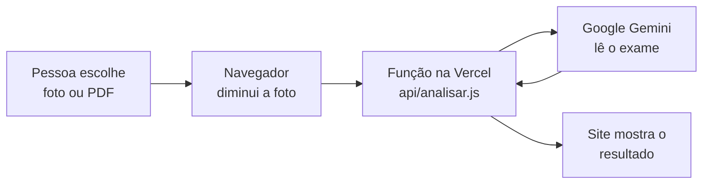

# ExamIA

**Seu hemograma, explicado em palavras simples.**

O ExamIA é um site que recebe a foto ou o PDF de um hemograma e explica cada valor em linguagem fácil: o que o item é, se está dentro da faixa de referência e o que um valor fora dela *pode* indicar.

🔗 **Site no ar:** https://expotec-tan.vercel.app

Projeto escolar feito para a **Expotec 2026**, no ITB Brasílio Flores de Azevedo (FIEB).

> **Importante:** o ExamIA **não faz diagnóstico** e **não substitui a consulta com um médico**.
> Ele só explica o que os valores podem indicar e sempre sugere procurar um profissional
> quando algo está fora da referência. Esse aviso aparece antes do envio (é preciso marcar
> uma caixa de confirmação) e em todo resultado.

---

## Por que existe

Muita gente recebe o hemograma antes da consulta e não entende nada: siglas como VCM e CHCM, números com unidades estranhas, valores em negrito. Isso pode gerar ansiedade ou fazer a pessoa buscar respostas assustadoras na internet.

O ExamIA traduz o exame para uma linguagem calma e simples, para a pessoa chegar à consulta entendendo melhor o próprio resultado.

## Como usar

1. Abra a página **Analisar exame**.
2. Escolha ou arraste a foto (JPG ou PNG) ou o PDF do hemograma. Uma prévia aparece para confirmar o arquivo.
3. Marque as duas confirmações:
   - que o exame não mostra nome, CPF ou outros dados pessoais;
   - que você entendeu que o ExamIA não faz diagnóstico.
4. Clique em **Analisar exame** e aguarde (geralmente de 10 a 20 segundos).
5. Veja o resumo e a explicação item por item, com selos **✓ Normal**, **! Um pouco acima** ou **! Acima da referência**.

### Para testar sem um exame de verdade

- A pasta [`img-teste/`](img-teste/) tem três hemogramas **fictícios** (sem dados de ninguém): um normal, um com valores um pouco acima e um com valores bem acima da referência.
- Ou use o botão **"Usar exame de exemplo"**, que mostra uma análise pronta e funciona até sem internet.

## Como funciona por dentro



1. **No navegador** (`js/analise.js`): o site confere o tipo e o tamanho do arquivo. Se for foto, ele a **diminui** para no máximo 1600 px antes de enviar: uma foto de celular de 5 MB vira algumas centenas de KB, o que deixa o envio mais rápido.
2. **Na função serverless** (`api/analisar.js`): um pequeno programa que roda nos servidores da Vercel recebe o arquivo e o envia para a IA **Google Gemini**, junto com as regras do projeto:
   - não diagnosticar;
   - usar linguagem simples e calma;
   - copiar os valores exatamente como estão no exame;
   - sugerir o médico quando algo estiver fora da referência;
   - nunca repetir dados pessoais.
3. **Formato fixo:** a IA é obrigada a responder num formato definido (resumo + lista de itens com nome, valor, referência, situação e explicação). Assim o site sempre sabe como mostrar o resultado.
4. **Conferência:** antes de devolver, a função confere e limpa a resposta. No site, todo texto da IA entra como **texto puro** (nunca como código), por segurança.
5. **Se algo falhar** (internet ruim ou IA sobrecarregada): a função tenta outros modelos do Gemini automaticamente. Se mesmo assim não der, o site oferece o exame de exemplo em vez de mostrar só uma mensagem de erro.

## Privacidade

Exame de sangue é **dado de saúde**, considerado sensível pela LGPD. Por isso:

- **Nada é salvo:** o site não tem banco de dados e não guarda o exame nem o resultado no navegador. Fechou a página, sumiu.
- **A chave da IA fica escondida:** ela fica só nas configurações da Vercel. Nunca aparece no código do site nem no GitHub.
- **Aviso honesto:** o projeto usa o plano gratuito do Gemini, em que o Google pode usar os dados enviados. Por isso a página de envio pede para **não enviar exames com nome ou dados pessoais** e exige uma confirmação antes de analisar.
- Em testes e na apresentação usamos só exames fictícios.

## Design e acessibilidade

O público inclui pessoas idosas e pessoas que ficam nervosas ao ler um exame, então cada escolha visual tem um motivo:

- **Fonte Atkinson Hyperlegible:** criada para pessoas com baixa visão. O texto tem 18 px, e nada no site é menor que 16 px.
- **Contraste mínimo de 4,5:1** em todo texto (padrão WCAG), conferido cor por cor.
- **Botões com pelo menos 48 px de altura**, fáceis de acertar no celular.
- **Sem vermelho para "alerta":** valores fora da referência usam um tom **terracota**, que chama atenção sem assustar.
- **A cor nunca é o único sinal:** todo selo tem ícone e palavra ("✓ Normal", "! Um pouco acima"), para quem não distingue cores.
- **Cores bege e verde** em vez do visual branco e azul de hospital, para passar calma.
- **Menos movimento:** quem ativa "reduzir movimento" no celular ou computador vê o site sem animações.
- **Feito primeiro para o celular** (mobile-first) e adaptado para telas maiores.

## Tecnologias

| Parte | Tecnologia |
|---|---|
| Páginas | HTML, CSS e JavaScript puro (sem frameworks) |
| Hospedagem | Vercel (site estático + função serverless) |
| Inteligência artificial | Google Gemini (API, plano gratuito) |
| Fontes | Fraunces (títulos) e Atkinson Hyperlegible (texto), do Google Fonts |

## Estrutura do projeto

```
index.html        Página inicial: o que é e como funciona
aviso.html        Aviso completo: o que o ExamIA faz e não faz
analise.html      Envio do exame e resultado
css/estilo.css    Todo o visual (cores e fontes em variáveis)
js/analise.js     Envio, prévia, checkboxes e montagem do resultado
js/exemplo.js     Exame de exemplo já analisado (funciona sem internet)
js/menu.js        Menu do celular
js/animacoes.js   Animações ao rolar a página
js/desenho.js     Células "sendo desenhadas" na página de Aviso
api/analisar.js   Função serverless que conversa com o Google Gemini
imagens/          Ilustrações e células decorativas
img-teste/        Hemogramas fictícios para testar
```

## Limites conhecidos

- **A IA pode errar ao ler o exame**, principalmente com fotos tortas, borradas ou com pouca luz. Por isso o resultado pede para conferir os valores com o papel.
- **Só hemogramas:** outros exames são recusados com um aviso.
- **Às vezes demora ou falha:** o plano gratuito do Gemini pode ficar sobrecarregado. Nesses casos, o botão "Tentar de novo" ou o exame de exemplo resolvem.
- **Não é um produto médico:** é um projeto escolar e não passou por validação clínica.

## Autor

**Eduardo Melo**, ITB Brasílio Flores de Azevedo (FIEB), Expotec 2026.
Contato: eduardomelo.090210@gmail.com
